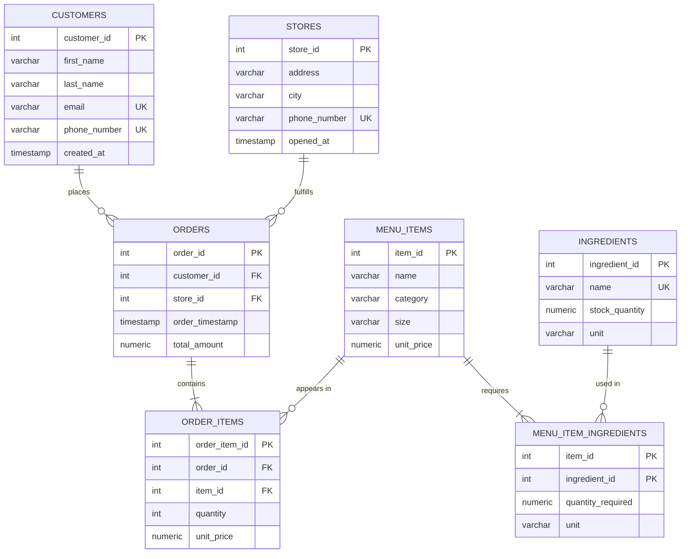

# Rushmore Pizzeria Database

A relational PostgreSQL database for a multi-store pizzeria, hosted on **Google Cloud SQL** and populated with realistic synthetic data using Python and Faker. The project covers schema design, bulk data generation, data quality verification, and query optimization with indexes.

## Table of Contents

- [Project Overview](#project-overview)
- [Tech Stack](#tech-stack)
- [Database Design](#database-design)
- [Repository Structure](#repository-structure)
- [How to Run the Project](#how-to-run-the-project)
- [Data Quality Verification](#data-quality-verification)
- [Query Optimization](#query-optimization)
- [Screenshots](#screenshots)
- [Design Decisions](#design-decisions)
- [Troubleshooting](#troubleshooting)
- [Author](#author)

## Project Overview

Rushmore Pizzeria operates multiple stores that sell pizzas, sides, desserts, and drinks. The database tracks customers, stores, menu items, ingredient stock, recipes, and customer orders.

The project demonstrates:

1. A normalized relational schema with primary keys, foreign keys, unique constraints, and check constraints.
2. A reproducible seeding script that loads about 130,000 rows in a single transaction.
3. SQL checks that prove the data is clean and internally consistent.
4. Measured performance improvements from indexing, using `EXPLAIN ANALYZE`.

### Data volumes

| Table | Rows |
|---|---|
| stores | 4 |
| customers | 6,000 |
| ingredients | 45 |
| menu_items | 25 |
| menu_item_ingredients | 75 to 150 (3 to 6 per menu item) |
| orders | 30,000 |
| order_items | 90,000 (3 items per order) |

## Tech Stack

- **Database:** PostgreSQL on Google Cloud SQL
- **Language:** Python 3.10+
- **Libraries:** `psycopg2-binary`, `Faker`, `python-dotenv`
- **Tools:** pgAdmin 4, Git

## Database Design



### Table summary

| Table | Purpose |
|---|---|
| `customers` | Customer contact details (unique email and phone) |
| `stores` | Store locations |
| `ingredients` | Ingredient inventory with stock levels and units |
| `menu_items` | Items for sale, with category, size, and a price that must be greater than 0 |
| `orders` | One row per order, linked to a store and (optionally) a customer |
| `order_items` | Line items for each order, with the unit price captured at time of sale |
| `menu_item_ingredients` | Many-to-many recipe table linking menu items to ingredients |

Notable constraints:

- `orders.customer_id` uses `ON DELETE SET NULL`, so deleting a customer keeps the sales history.
- `orders.store_id` uses `ON DELETE RESTRICT`, so a store with orders cannot be deleted.
- `menu_items.unit_price` has `CHECK (unit_price > 0)`.
- `menu_item_ingredients` uses a composite primary key `(item_id, ingredient_id)`.

## Repository Structure

```
rushmore-pizzeria-db/
├── README.md
├── schema.sql              # CREATE TABLE statements
├── populate.py             # Faker-based data generation script
├── verification.sql        # Data quality checks and optimization proof
├── requirements.txt        # Python dependencies
├── .env.example            # Template for database credentials
├── .gitignore
└── docs/
    └── screenshots/        # Evidence screenshots used in this README
```

## How to Run the Project

### 1. Prerequisites

- Python 3.10 or newer
- A PostgreSQL database on Google Cloud SQL (or any PostgreSQL server)
- pgAdmin 4 (or `psql`) for running SQL scripts

### 2. Clone the repository

```bash
git clone https://github.com/<your-username>/rushmore-pizzeria-db.git
cd rushmore-pizzeria-db
```

### 3. Create a virtual environment and install dependencies

Windows (PowerShell):

```powershell
python -m venv .venv
.venv\Scripts\Activate.ps1
python -m pip install -r requirements.txt
```

macOS / Linux:

```bash
python3 -m venv .venv
source .venv/bin/activate
python -m pip install -r requirements.txt
```

### 4. Prepare the Cloud SQL instance

1. In the Google Cloud console, open your Cloud SQL instance and note its **Public IP address**.
2. Under **Connections > Networking > Authorized networks**, add your current public IP so your machine is allowed to connect.
3. Create a database named `Rushmore_pizzeria` (for example in pgAdmin: right-click Databases > Create > Database).

Database names created in pgAdmin keep their capitalization, so use the exact spelling in your `.env` file.

### 5. Configure environment variables

Copy the template and fill in your own values:

```bash
cp .env.example .env
```

```
DB_HOST=<cloud sql public ip>
DB_PORT=5432
DB_NAME=Rushmore_pizzeria
DB_USER=postgres
DB_PASSWORD=<your password>
DB_SSLMODE=require
```

The `.env` file is listed in `.gitignore` and must never be committed.

### 6. Create the tables

Open the Query Tool on the `Rushmore_pizzeria` database in pgAdmin, paste the contents of `schema.sql`, and run it. Confirm the seven tables appear under **Schemas > public > Tables**.

### 7. Populate the database

```bash
python populate.py
```

Expected output:

```
Connecting to PostgreSQL...
Connection successful!
Generating stores...
Inserted 4 stores.
Generating customers...
Inserted 6000 customers.
Generating ingredients...
Inserted 45 ingredients.
Generating menu items...
Inserted 25 menu items.
Generating menu-item ingredient relationships...
Inserted <n> menu-item ingredient records.
Generating 30000 orders...
Inserted 30000 orders.
Inserted 90000 order items.

===================================
DATABASE POPULATION COMPLETED!
===================================
```

All inserts run in a single transaction. If anything fails, everything is rolled back and the database is left empty.

### 8. Verify the data

Run `verification.sql` in the Query Tool, one section at a time (see the next two sections).

### Re-running the script

The script is not idempotent: unique constraints on emails, phones, and ingredient names will cause a second run to fail. To start over, clear the tables first:

```sql
TRUNCATE order_items, orders, menu_item_ingredients,
         menu_items, ingredients, customers, stores
RESTART IDENTITY CASCADE;
```

## Data Quality Verification

`verification.sql` (Part 1) runs the following checks. Every integrity check should return `issues_found = 0` and `PASS`.

| Category | Checks |
|---|---|
| Row counts | Actual rows versus expected rows for every table |
| Referential integrity | No orphaned `order_items`, `orders`, or recipe rows |
| Uniqueness | No duplicate customer emails or phone numbers; no duplicate items within an order |
| Value ranges | No zero or negative quantities, prices, order totals, or ingredient stock; no future-dated orders |
| Business rules | Each `orders.total_amount` equals the sum of its line items; each line price matches the menu price; every order has line items; every menu item has a recipe |
| Distribution | Orders and revenue per store, orders per month, min/avg/max order value |

**Result:** _All integrity checks passed (see screenshot below)._

## Query Optimization

`verification.sql` (Part 2) measures four representative queries with `EXPLAIN (ANALYZE, BUFFERS)` before and after creating indexes. PostgreSQL does not automatically index foreign key columns, so the joins and filters start as sequential scans.

Indexes created:

```sql
CREATE INDEX idx_orders_customer_id   ON orders (customer_id, order_timestamp DESC);
CREATE INDEX idx_orders_store_time    ON orders (store_id, order_timestamp);
CREATE INDEX idx_orders_timestamp     ON orders (order_timestamp);
CREATE INDEX idx_order_items_order_id ON order_items (order_id);
CREATE INDEX idx_order_items_item_id  ON order_items (item_id);
CREATE INDEX idx_mii_ingredient_id    ON menu_item_ingredients (ingredient_id);
```

Fill in your measured results:

| Query | Before (ms) | After (ms) | Scan type before | Scan type after |
|---|---|---|---|---|
| A: Order history for one customer | _ | _ | Seq Scan | Index Scan |
| B: Line items for one order | _ | _ | Seq Scan | Index Scan |
| C: Monthly revenue for one store | _ | _ | _ | _ |
| D: Top 10 best-selling items | _ | _ | _ | _ |

Queries that aggregate most of a table (such as D) may keep using a sequential scan even with indexes, because reading the whole table is cheaper than jumping through an index. That is expected planner behavior, not a failure.

## Screenshots

### Table row counts (pgAdmin connected to Cloud SQL)


### Integrity checks


### EXPLAIN ANALYZE: before and after indexing


## Design Decisions

- **Prices live on `menu_items`; `order_items` keeps its own `unit_price`.** Capturing the price at time of sale means later menu price changes do not rewrite order history.
- **Order totals are computed from line items** in the script, so `total_amount` always reconciles with `order_items` (verified by the business-rule check).
- **Recipe units reuse each ingredient's stock unit**, so recipes and inventory are consistent.
- **Bulk inserts use `execute_values`** with batching, which is much faster than row-by-row inserts over a network connection to Cloud SQL.
- **Fixed random seeds** (`random.seed(42)`, `Faker.seed(42)`) make the generated data reproducible.
- **Single transaction** guarantees the database is either fully populated or untouched.
- **Credentials come from environment variables**, loaded with `python-dotenv`, and are kept out of version control.

## Troubleshooting

| Problem | Likely cause and fix |
|---|---|
| `ModuleNotFoundError: No module named 'psycopg2'` | Packages were installed into a different Python. Use `python -m pip install -r requirements.txt` with the same interpreter that runs the script. |
| Connection timeout | Your current public IP is not in Cloud SQL **Authorized networks**. |
| `password authentication failed` | `DB_USER` or `DB_PASSWORD` does not match a user on the instance. |
| `database "..." does not exist` | `DB_NAME` must match the exact capitalization used in pgAdmin. |
| `relation "stores" does not exist` | `schema.sql` was run against a different database. Run it from the Query Tool of `Rushmore_pizzeria`. |
| Unique violation on rerun | Tables already contain data. Truncate them (see [Re-running the script](#re-running-the-script)). |

## Author

**<Your Name>**
GitHub: [@your-username](https://github.com/your-username)
